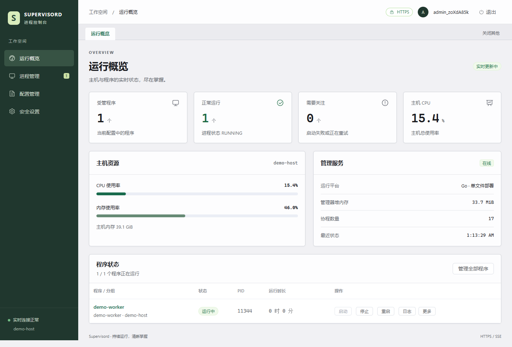

# 架构、页面与接口约定

## 模块职责

| 模块 | 职责及边界 |
| --- | --- |
| `main.go`、`service.go`、`daemonize*` | 参数、环境文件、前台/systemd/Windows 服务生命周期 |
| `supervisor.go`、`xmlrpc.go`、`ctl.go` | 配置协调、进程操作、兼容 RPC 与 CLI |
| `config/` | 保留引号的 INI 读取、有限表达式展开、依赖校验、不可变配置快照、原子写回 |
| `process/` | argv、工作目录、子进程 Wait、停止升级、钩子、健康检查和文件变更监听 |
| `logger/` | 文件/内存/标准流/syslog 输出、轮转、日志游标和有界读取 |
| `events/` | 事件格式、订阅注册、有限队列、通信捕获和解除订阅 |
| `management_server.go`、`web_security.go`、`web_waf.go` | TLS、HTTP/2、会话、CSRF、Coraza 与请求资源限制 |
| `console_api.go`、`remote_*.go` | 新控制台 API、共享状态采样、日志 SSE、已配置节点代理 |
| `frontend/src/`、`webgui/`、`assets.go` | Vue 源码、Vite 产物、嵌入静态服务 |
| `xmlrpcclient/`、`internal/rpcauth/` | 独立工作区客户端模块、共用 RPC 签名规范 |

运行路径：conf → 候选配置校验 → Supervisor 协调 → Process Manager；浏览器 → TLS → 请求限制/安全响应头 → Coraza → 会话/CSRF → 控制台或兼容 API。配置写入与操作仅接受固定业务字段，不提供网页任意 shell 命令入口。

## 页面与组件复用

参考 `tg-dice-service` 的深绿色导航、浅灰工作区、白色卡片和紧凑边框，采用 Element Plus 控件，不引入外部 CDN/字体。

| 页面 | 内容 | 共用能力 |
| --- | --- | --- |
| 登录 | 随机账号密码、错误及忙碌状态 | `api.js` 请求与错误处理 |
| 运行概览 | 进程数量、异常数、主机资源、管理器堆/协程 | 状态 store、`ProcessTable` |
| 进程管理 | 搜索、节点/分组/状态过滤、分页、批量操作 | 同一张进程表与操作确认 |
| 程序日志 | stdout/stderr、暂停、滚动、换行、片段下载与清空 | `live.js` 连接、`tabs.mjs` 保留策略 |
| 配置管理 | 脱敏设置、示例、加载文件变更 | 固定 config API，无重复编辑器 |
| 安全设置 | 修改密码、TLS/协议/WAF 信息 | 同一登录会话与 CSRF 处理 |

最多保存 16 个标签，进程标签由“节点 + 程序名”标识，stdout/stderr 共用同一标签。localStorage 只保存经过白名单恢复的标签，不保存密码、Cookie 或 CSRF。非活动日志页面卸载，关闭其流和计时器。列表每页 50 行；概览最多显示 10 行。

## 新 API

JSON 写请求使用 `Content-Type: application/json`。除登录及静态页面外均需会话，写操作还需 `X-CSRF-Token`。错误格式统一为 `{"error":"说明"}`。

| 方法和路径 | 请求/行为 |
| --- | --- |
| `POST /api/auth/login` | `{username,password}`，返回 username、csrf_token、expires_at 并设置安全 Cookie |
| `GET /api/auth/session` | 当前会话；未登录 401 |
| `POST /api/auth/logout` | 删除会话和 Cookie |
| `POST /api/auth/password` | `{current_password,password}`，成功后废止全部会话 |
| `GET /api/processes` | 本节点进程列表，供旧客户端及远端使用 |
| `GET /api/status` | 本节点状态快照，避免远端递归聚合 |
| `GET /api/events` | 聚合状态 SSE；`?local=1` 仅本节点 |
| `POST /api/process/action` | `{name,action,node?}`，action 为 start/stop/restart/kill，202 表示接受 |
| `GET /api/logs` | 查询 name、stream、node；返回最新片段，download=1 返回文本附件 |
| `GET /api/logs/events` | 同样查询参数，增量日志 SSE |
| `POST /api/logs/clear` | `{name,stream,node?}`，清空对应日志 |
| `GET /api/config` | 脱敏配置、实际监听地址、TLS 公开指纹/有效期、WAF/当前协议 |
| `POST /api/config/reload` | 202 异步加载 conf，重复任务 409；失败原因通过状态快照报告 |

业务进程操作任务最多并行 8 个，同一程序互斥；有待处理停止任务时仍可立即升级 kill。202 不代表操作已经完成，应等待 SSE 状态更新。队列满返回 429；批量提交仅对明确未接受的 429 有界等待重试，可取消剩余提交。连接不可用时前端禁用操作。兼容 `/RPC2`、`/program/*`、`/supervisor/*` 保留原业务接口，但统一要求新认证。

## SSE 与资源所有权

- 一个控制台会话共享一个状态 EventSource；只有当前日志页面额外建立一条日志流。服务端状态每 2 秒共享采样，只在有订阅时工作；不按每个浏览器重复采样。
- `snapshot` 为完整快照；`log` 带 text/reset，`heartbeat` 为心跳，`session-expired` 通知登录失效，`unavailable` 通知程序移除。状态队列容量 1，慢客户端丢弃旧快照；日志保留有限片段。
- 日志每秒按字节游标读取增量；通过 logger 实例及 generation 检查重新启动/清空/轮转。断线后重新获取最新 64 KiB，不声称精确一次交付。
- 每 15 秒心跳，流写有期限；前端 45 秒无事件重连，指数退避最多 30 秒并带抖动。错误后探测会话，401 返回登录。后台标签暂停连接，恢复可见后重建快照。
- 页面卸载/退出关闭 EventSource、重试计时器、watchdog、会话探测及 visibility 监听；服务端请求取消即解除订阅。远端 reader 拥有响应体和 watchdog，取消时关闭，再清理 transport 空闲连接。
- Console 拥有采样与远端 goroutine；关闭先取消 context，拒绝新任务，再等待已登记任务。Manager 拥有健康调度；Process 拥有重启循环、cron entry、文件监听和日志；Close 必须可重复调用。
- 所有内部受管/辅助命令通过 `process.StartCommand`/`WaitCommand` 或 `RunCommand` 成对运行。PID 所有权跨 Start 登记并保留到 Wait 返回，PID 1 回收器在同一锁内跳过这些孩子；不能仅按 zombie 存在时长推断为孤儿。

## 修改代码时保持的约束

1. 不在 Manager 锁内调用业务回调或做外部 I/O；配置快照发布后不原地修改共享 map。
2. 新 goroutine 必须说明所有者和结束条件；新 timer/ticker、HTTP body、socket、文件必须在异常路径同样释放。
3. 新页面复用状态表、API 错误和 SSE 生命周期；不要另外实现轮询器、登录存储或日志缓存。
4. 进程文件操作和命令只来自管理员 conf，网页请求只按已配置标识操作。日志按文本渲染，禁止 v-html。
5. Go 二进制必须在不依赖源码目录和网络前端资源的条件下运行；前端变更同时更新 `webgui/` 构建产物。
